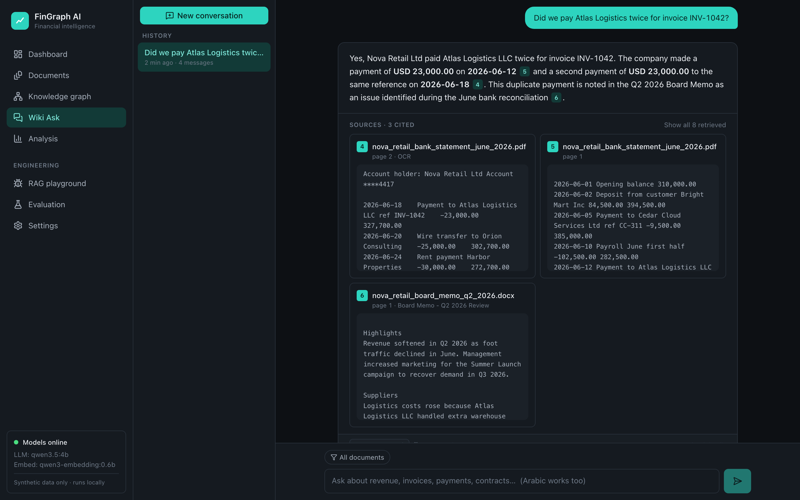
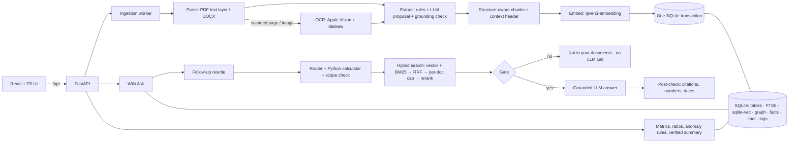
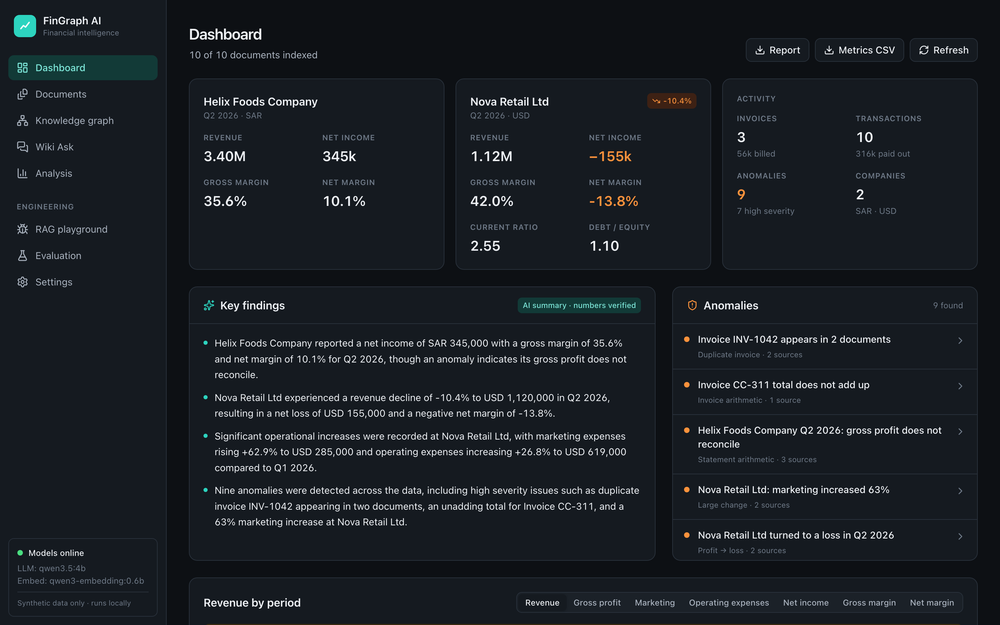
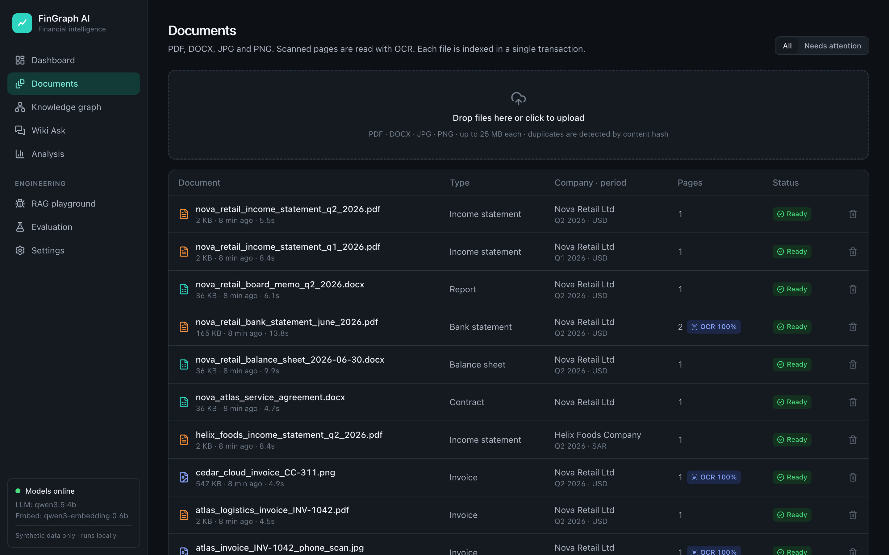
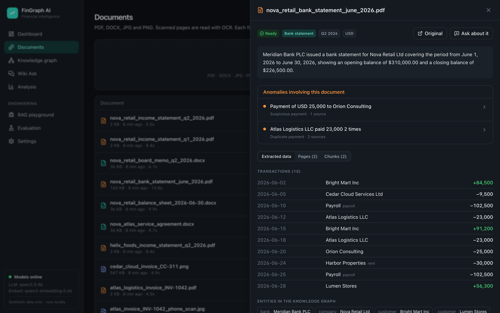
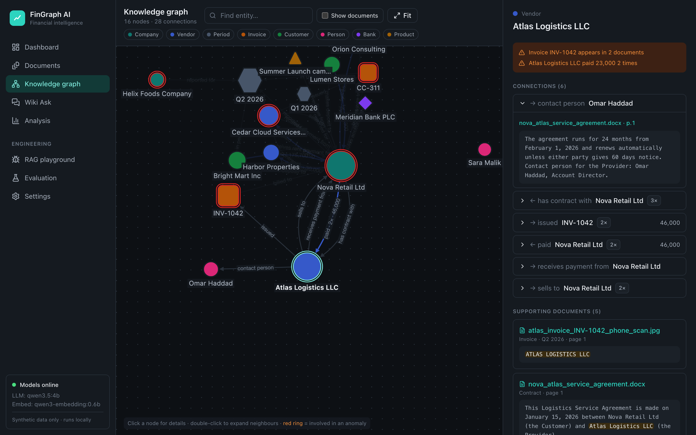
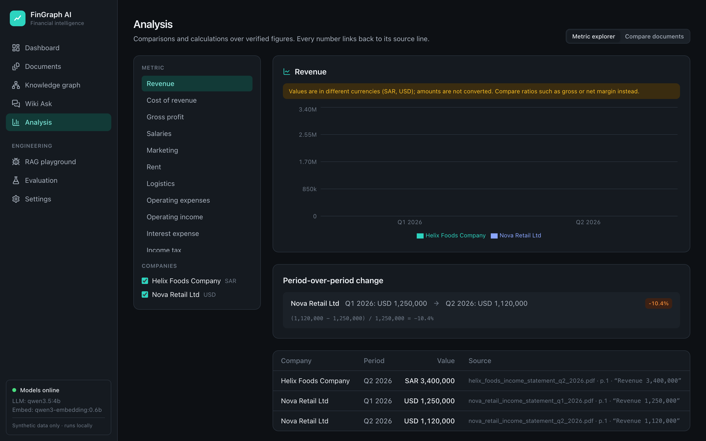
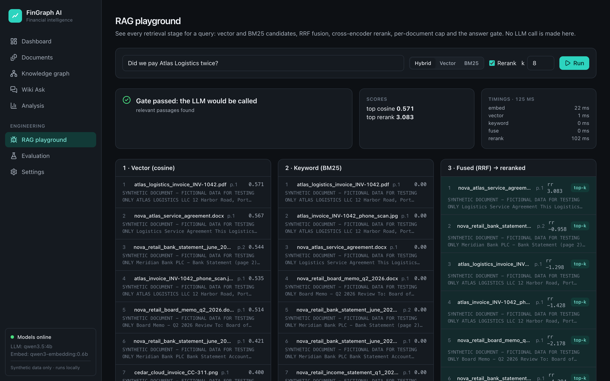
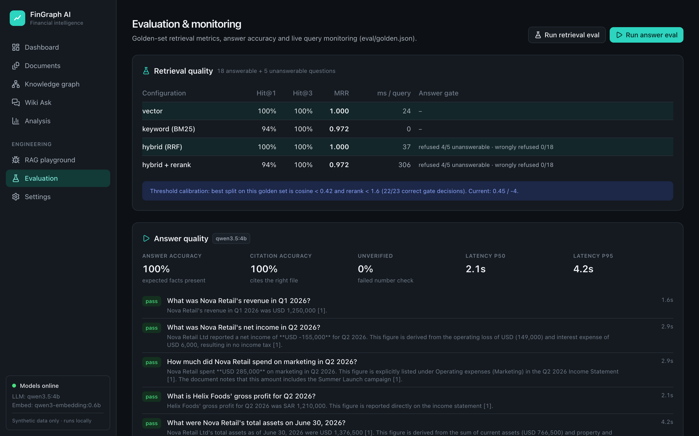

# FinGraph AI · Financial Intelligence Workspace

Upload financial documents (PDF, DOCX, scanned JPG/PNG), turn them into a searchable knowledge base and a
knowledge graph, and ask questions that are answered **with citations, verified numbers and code-computed
calculations**. Runs fully locally on [Ollama](https://ollama.com); one setting switches the answer model to any
OpenAI-compatible cloud endpoint.

> All data in this repository is **synthetic**. No real company or customer information is used.



## Highlights

- **Grounded answers you can audit:** every claim cites `[n]` sources with the exact excerpt, page and retrieval scores.
- **The LLM explains; Python calculates:** changes, ratios and comparisons are computed from verified figures and shown in a *Calculation* box.
- **Four layers against wrong answers:**
  1. A retrieval gate refuses before any LLM call.
  2. A scope check says which periods and companies exist.
  3. Partial answers are allowed, with the missing part named.
  4. A post-check verifies citations, numbers and dates, retries once, and otherwise shows an "unverified" banner.
- **The LLM proposes; code verifies** during extraction: rules parse statements, invoices and bank lines first. LLM-proposed numbers and names are accepted only if they literally appear in the text.
- **Anomaly detection with evidence:**
  - duplicate invoices, including a PDF and a phone photo of the same invoice;
  - invoice and statement arithmetic errors;
  - large period swings and profit-to-loss changes;
  - duplicate payments;
  - round weekend payments to counterparties with no invoice or contract.
- **One atomic store:** SQLite holds the tables, FTS5 BM25 and sqlite-vec vectors. A document's chunks, vectors, graph edges and figures are committed or deleted in **one transaction**.
- **Engineering views:**
  - a RAG playground showing every retrieval stage;
  - a golden-set evaluation of retrieval and answers;
  - live monitoring of latency and abstain/unverified rates;
  - a measured scale benchmark.

## Requirements coverage

| Requirement | Where |
|---|---|
| Upload PDF/DOCX/JPG/PNG, parsing + OCR, status, delete | **Documents** page · `fingraph/parsing.py`, `ingest.py` |
| Chunking, embeddings, vector store, semantic retrieval, metadata + source references, grounded answers, insufficient-information handling | `chunking.py`, `retrieval.py`, `answer.py` |
| Interactive knowledge graph of companies, vendors, invoices, transactions, periods, with supporting documents | **Knowledge graph** page · `extract.py`, `graph.py` |
| Wiki Ask: chat, citations + excerpts, multi-document questions, history | **Wiki Ask** page · `answer.py`, `router.py` |
| Financial metrics, comparisons and calculations, key-findings summary | **Dashboard**, **Analysis** · `finance.py` |
| Dashboard, library, graph and Wiki Ask with loading/processing/error states | `web/src` |
| **Bonus:** hybrid search + reranking | BM25 + vectors → RRF → MiniLM cross-encoder |
| **Bonus:** anomaly detection | 9 explainable rules, computed at read time |
| **Bonus:** document comparison | **Analysis → Compare documents** |
| **Bonus:** RAG debugging playground with chunks and scores | **RAG playground** |
| **Bonus:** retrieval evaluation and performance monitoring | **Evaluation** · `evals.py`, `reports/eval.md` |
| **Bonus:** exportable reports | HTML (print to PDF), Markdown, CSV (metrics, anomalies) |
| **Bonus:** local and cloud LLMs | **Settings**: switch at runtime (Ollama / OpenAI-compatible) |

## Quick start

**Requirements:**
- macOS (Apple Vision OCR; other OSes fall back to LLM-vision OCR) or Linux;
- Python 3.12 with [uv](https://docs.astral.sh/uv/);
- Node.js 20+;
- [Ollama](https://ollama.com).

```bash
ollama pull qwen3.5:4b
```

```bash
ollama pull qwen3-embedding:0.6b
```

```bash
./run.sh
```

`run.sh` installs Python and npm dependencies, builds the React app once, and serves everything from one process at
**http://127.0.0.1:8720**. On first use the reranker (`Xenova/ms-marco-MiniLM-L-6-v2`, about 90 MB) downloads into
`.models/`.

Load the 10 synthetic documents. Either drag `samples/docs/*` into the Documents page, or run:

```bash
uv run python scripts/load_samples.py
```

The other scripts:

| Task | Command |
|---|---|
| Regenerate the synthetic documents | `uv run python samples/generate.py` |
| Run the tests (offline; fake models, real parsing/OCR/storage) | `uv run pytest -q` |
| Evaluate retrieval and answers on the golden set (writes `reports/eval.md`) | `uv run python scripts/run_eval.py` |
| Measure vector and keyword search latency at 10k–100k chunks | `uv run python scripts/bench_scale.py` |
| Frontend development with hot reload (proxies `/api` to :8720) | `cd web && npm run dev` |

### Configuration (environment variables)

| Variable | Default | Meaning |
|---|---|---|
| `FINGRAPH_LLM` | `ollama:qwen3.5:4b` | Answer/extraction model; `openai:<model>` for cloud |
| `FINGRAPH_EMBEDDER` | `ollama:qwen3-embedding:0.6b` | Embedding model; **fixed per index** |
| `OPENAI_API_KEY`, `OPENAI_BASE_URL`, `OPENAI_MODELS` | none | Any OpenAI-compatible endpoint: OpenAI, Azure, Groq, vLLM, LM Studio. Models appear in Settings |
| `FINGRAPH_RERANK` | `1` | Cross-encoder reranking on/off |
| `FINGRAPH_MIN_SIM`, `FINGRAPH_MIN_RERANK` | `0.45`, `-4.0` | Answer-gate thresholds, calibrated on the golden set |
| `FINGRAPH_OCR` | `auto` | `vision` (Apple), `llm` (multimodal model), or auto |
| `FINGRAPH_DATA` | `./data` | Where the SQLite file and uploads live |

## Architecture



The full diagram, with a table of design decisions and their enterprise alternatives, is in
[docs/architecture.md](docs/architecture.md).

## How the RAG pipeline works

1. **Parsing.**
   - PDF pages with a real text layer are read directly (pypdfium2).
   - Pages with fewer than 50 characters are rendered at 200 DPI and OCR'd.
   - JPG/PNG files are deskewed (projection profile), then read with Apple Vision. Text boxes are regrouped into lines, so "Subtotal … 20,000.00" stays on one row.
   - Each page stores its method and OCR confidence; the UI shows an OCR badge.
   - DOCX keeps paragraphs and tables in document order.
2. **Extraction.**
   - Deterministic rules read statement line items (22 canonical metrics with synonyms), invoice fields and bank transactions.
   - Each number is stored with its page and exact source line.
   - qwen3.5 (JSON mode) classifies the document and proposes entities, relations and a summary. Names must appear in the text, and numbers must appear literally, or they're rejected.
   - IDs are normalized (OCR `INV-1O42` becomes `INV-1042`), and company names too (`NOVA RETAIL LIMITED` = `Nova Retail Ltd`). Short names are not merged.
3. **Chunking.**
   - Chunks follow headings and pages and never cross pages. Tables stay whole; split tables repeat their header row.
   - Each chunk gets a **context header** that is embedded and indexed but not shown as the citation text, for example: `[Nova Retail Ltd · Income statement · Q2 2026 · file · page 1 · section]`.
   - This matters because, in finance, "Revenue 1,120,000" is useless without its company and period.
4. **Indexing.**
   - `qwen3-embedding:0.6b` (1024-d) vectors go into sqlite-vec, text into FTS5 (porter stemming, header weighted 2×).
   - Everything for one document is committed in a single transaction.
5. **Retrieval.**
   - Vector top-30 and BM25 top-30 are fused with **Reciprocal Rank Fusion** (k=60), then reranked by a MiniLM cross-encoder.
   - Reranking is skipped automatically for Arabic questions, because the reranker is English-only.
   - A **per-document cap** (3) keeps multi-document questions balanced, and the top 8 are kept.
6. **Answering.**
   - Follow-ups are rewritten into standalone questions; the UI shows "Searched for".
   - The router detects metrics, companies and periods, and the calculator computes changes, ratios and cross-company comparisons. It refuses to compare different currencies.
   - The LLM receives the sources, the verified calculations (with their source numbers) and the "not available" notes.
7. **Verification.** Every `[n]` must exist, and every number and date must appear in a cited source or a calculation. Otherwise the answer is regenerated once with a stricter prompt, then flagged.

## Results

Measured on an Apple M5 MacBook (16 GB) with `qwen3.5:4b`. The full report is in [reports/eval.md](reports/eval.md).

Golden set (`eval/golden.json`): 18 answerable and 5 unanswerable questions, including multi-document questions,
calculations and a scanned page read by OCR.

| Retrieval | Hit@1 | Hit@3 | MRR | ms/query | Unanswerable refused by the gate | Answerable wrongly refused |
|---|---|---|---|---|---|---|
| Vector only | 100% | 100% | 1.000 | 24 | – | – |
| BM25 only | 94% | 100% | 0.972 | <1 | – | – |
| Hybrid (RRF) | 100% | 100% | 1.000 | 37 | 4/5 | 0/18 |
| Hybrid + rerank | 94% | 100% | 0.972 | 306 | 4/5 | 0/18 |

| Full pipeline (Wiki Ask) | Result |
|---|---|
| Answer accuracy: expected facts present, or a correct refusal | **100%** (23/23) |
| Citation accuracy: cites an expected document | **100%** |
| Answers flagged unverified | 0% |
| Latency | p50 2.1 s · p95 4.2 s |

**How to read these numbers honestly:**
- **The set is small and easy for retrieval.** Reranking did not improve ranking here; it adds about 270 ms.
- **The reranker earns its place in the gate.** Answerable questions score +1.6 to +8.6, and off-topic ones about −11. Cosine similarity alone overlaps more: 0.42–0.79 vs 0.28–0.32.
- **The one unanswerable question the gate lets through is by design.** "Nova's revenue in Q4 2025" retrieves relevant passages, so it is caught one layer later by the router's scope check: "only Q1–Q2 2026 are available".
- **During testing, the post-check caught two real hallucinations:**
  - a gross margin computed wrongly by the LLM, now done by the Python calculator;
  - a wrong payment date. The date check was added, and the retry fixed the answer.

**Ingestion:**
- All 10 sample documents are processed in about 70 s.
- About 4–6 s per text document; the scanned bank statement takes about 14 s.
- OCR takes about 0.3 s per page.

**Scale benchmark** (`scripts/bench_scale.py`, random 1024-d vectors):

| Chunks | Vector KNN p50 | BM25 p50 | Vector storage |
|---|---|---|---|
| 10,000 | 9.8 ms | 3.3 ms | 41 MB |
| 50,000 | 49.4 ms | 16.3 ms | 205 MB |
| 100,000 | 99.2 ms | 33.0 ms | 410 MB |

sqlite-vec is exact (brute force), so search time grows linearly: about 1 ms per 1,000 chunks. Beyond a few hundred
thousand chunks, the repository layer should move to Postgres + pgvector (HNSW) or quantized vectors.

## Screenshots

| | |
|---|---|
|  |  |
|  |  |
|  |  |
|  |  |

A walkthrough for a live demo is in [docs/DEMO_SCRIPT.md](docs/DEMO_SCRIPT.md).

## Limitations

- **Extraction rules** target common statement, invoice and bank-statement layouts. These are not handled yet:
  - multi-column statements (only the first number column is read);
  - European number formats (`1.250.000,00`);
  - non-calendar fiscal years.
- **The golden set is small** (23 questions over 10 documents), so retrieval scores are near the ceiling. It proves the harness, not general quality. A larger, adversarial set is the next step.
- **Entity resolution is deliberately conservative**: "Nova" alone is not merged with "Nova Retail Ltd".
- **A 4B local model** is fast but limited. Complex multi-hop questions are better with qwen3.5:9b or a cloud model, which are switchable in Settings.
- **Single user, no authentication;** one SQLite writer.
- **Apple Vision OCR is macOS only.** Elsewhere, OCR falls back to the LLM's vision mode, which is slower and less reliable.

## What I would add for an enterprise deployment

- **Security:**
  - SSO, role-based access and per-document permissions enforced *inside* retrieval (pre-filter), not after;
  - an audit log of every question and answer;
  - PII redaction before indexing;
  - encryption at rest.
- **Scale:**
  - Postgres + pgvector (HNSW), behind the same `Store` interface;
  - a job queue (Celery or Temporal) with many ingestion workers;
  - GPU inference with batching (vLLM) or a governed cloud LLM;
  - answer caching.
- **Quality:**
  - layout-aware table extraction (Textract, Azure Document Intelligence or Docling);
  - a multilingual reranker for Arabic (bge-reranker-v2-m3);
  - an optional LLM-judge "strict mode";
  - a larger golden set with regression tests in CI.
- **Observability:** OpenTelemetry traces per stage (parse, OCR, embed, retrieve, generate, verify), plus dashboards and alerts on abstain/unverified rates and latency.
- **Agents:** a tool-calling agent (search, get_metric, calculate, compare) for multi-step analysis once a stronger model is available.

## Project structure

```
fingraph/            Python backend
  api.py             FastAPI routes + serves the built web app
  config.py          settings (env vars)
  models.py          Ollama / OpenAI-compatible chat + embeddings, cross-encoder reranker, offline fakes
  store.py           repository: one SQLite file (tables, FTS5, sqlite-vec), atomic commit/delete
  parsing.py         PDF / DOCX / image parsing, Apple Vision OCR, deskew, line rebuilding
  extract.py         rule-based financial extraction + LLM proposal + grounding checks
  chunking.py        structure-aware chunking with context headers
  ingest.py          background worker, stages, retry, cancel, crash recovery
  retrieval.py       hybrid search, RRF, rerank, per-doc cap, answer gate
  router.py          question router + deterministic calculator + scope check
  answer.py          Wiki Ask: rewrite, prompt, generation, post-check, history, logging
  finance.py         metrics, ratios, comparisons, anomaly rules, verified summary
  graph.py           knowledge graph API
  evals.py           golden-set evaluation, threshold calibration, monitoring
  reports.py         Markdown / HTML / CSV exports
web/                 React + TypeScript + Vite + Tailwind + Cytoscape + Recharts
samples/             synthetic document generator + 10 generated documents
eval/golden.json     evaluation questions
scripts/             load samples, run eval, scale benchmark
tests/               pytest suite (offline)
docs/                architecture, demo script, screenshots
```
