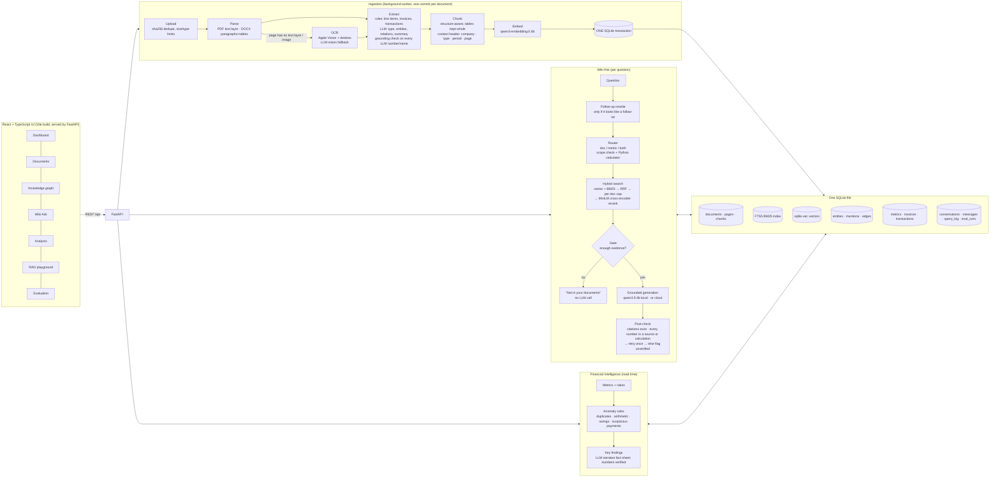

# FinGraph AI · Architecture

## Why these pieces

| Decision | Choice | Reason | Enterprise path |
|---|---|---|---|
| Storage | One SQLite file: tables + FTS5 + sqlite-vec | A document's chunks, vectors, graph edges and facts are written and deleted in **one transaction**; zero setup | Same repository interface on Postgres + pgvector (HNSW) + full-text search |
| Numbers | Rules first, LLM proposes, code verifies | A 4B model can misread numbers; every figure keeps its page and source line | Layout-aware parsers (e.g. Textract / Document Intelligence) behind the same extractor |
| Chunking | Structure-aware + context header | “Revenue 1,120,000” is meaningless without company and period | Same |
| Calculations | Router + Python calculator | LLMs are unreliable at arithmetic; formula shown to the user | Tool-calling agent with a stronger model |
| Hallucination control | Gate before LLM, scope check, partial answers, post-check | Refusal decided in code; numbers verified after generation | Optional LLM-judge “strict mode” |
| Ingestion | Background worker, stage in memory, commit once | No half-indexed documents; crash recovery re-queues | Job queue (Celery/Temporal) with many workers |
| OCR | Apple Vision with deskew, per page | Offline (data stays local), 0.3 s/page | Cloud OCR when the data policy allows |
| Models | Ollama local by default, OpenAI-compatible switch at runtime | Confidential data stays on the machine | vLLM/TGI GPU serving with batching |
| Anomalies | Deterministic rules, computed at read time | Explainable to an auditor; never stale after a delete | Statistical / ML detectors once there is volume |
